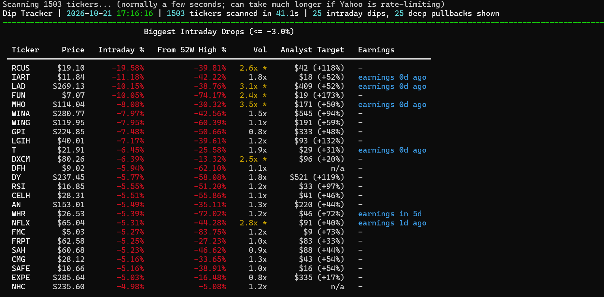
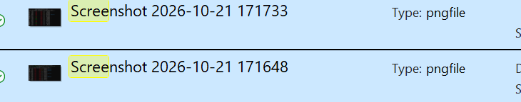

# Dip Tracker

A command-line scanner that watches about 1,500 US stocks and flags the ones
that are falling.




## Why I built this

I've always heard "buy the dip" as a rule of thumb for the stock market. That
made me wonder if there was a more efficient way to find falling stocks and see
how serious each drop really is. So I built my own dip tracker.

## How it works

It scans the market on a loop and flags stocks that are "dipping" on two
independent signals:

- **Intraday drops** — today's move vs. yesterday's close
- **Drawdowns** — how far a stock has fallen from its trailing 52-week high

Data comes free from Yahoo Finance (via `yfinance`). During market hours it's
typically about a minute or so behind real-time — good enough for spotting
dips, not for order execution.

**Universe**: the S&P Composite 1500, which combines the S&P 500 (large-cap),
the S&P MidCap 400 (mid-cap) and the S&P SmallCap 600 (small-cap). The ticker
lists are scraped from Wikipedia and cached locally for a week. There's no free feed that covers literally every US-listed ticker, so
this is the practical "everything that matters" stand-in. Use `--universe
sp500` for a faster, large-cap-only scan (~500 tickers, ~10-15s per cycle).

## Setup

```
pip install -r requirements.txt
```

## Usage

Live loop, refreshing every 5 minutes (default), S&P 1500, market open or not:

```
python dip_tracker.py
```

One-off scan and exit:

```
python dip_tracker.py --once
```

Faster large-cap-only scan every minute:

```
python dip_tracker.py --universe sp500 --interval 60
```

Looser filters (more noise) or tighter filters (fewer, bigger dips):

```
python dip_tracker.py --intraday-threshold -2 --drawdown-threshold -20
```

## Options

| Flag | Default | Meaning |
|---|---|---|
| `--universe` | `sp1500` | `sp500` or `sp1500` (S&P 500+400+600) |
| `--intraday-threshold` | `-3.0` | Flag stocks down at least this % today |
| `--drawdown-threshold` | `-10.0` | Flag stocks at least this % below their 52w high |
| `--interval` | `300` | Seconds between refreshes |
| `--once` | off | Run one scan and exit (no loop) |
| `--top` | `25` | Rows shown per table |
| `--min-price` | `5.0` | Ignore stocks priced below this |
| `--log` | `dip_alerts.csv` | Where newly-triggered alerts get appended |
| `--refresh-tickers` | off | Force re-fetch of the ticker list from Wikipedia |
| `--volume-threshold` | `2.0` | Flag today's volume as a spike at this multiple of the 20-day average |
| `--earnings-window` | `5` | Note "earnings Nd ago" within this many days after a report |
| `--earnings-lookahead` | `5` | Note "earnings in Nd" within this many days before a report |
| `--no-enrich` | off | Skip analyst target / earnings lookups entirely (faster) |

## Context columns (for judging *why* a stock dipped)

Beyond price, each dip row also shows:

- **Vol** — today's volume vs. its trailing 20-day average. A move on 3x
  normal volume means something real happened (news, earnings); a move on 0.5x
  volume is quieter and more likely to be noise. A `*` marks a spike at or
  above `--volume-threshold`.
- **Analyst Target** — Wall Street's mean 12-month price target and the
  implied upside/downside from the current price (`n/a` if no analysts cover
  it). This is a consensus opinion, not a guarantee — treat it as one data
  point, not a signal to act on.
- **Earnings** — flags if the stock reported earnings recently (the single
  most common reason for a sharp one-day move) or reports again soon (a real
  risk if you're considering buying into the dip: another gap move could be
  days away). Blank (`-`) means neither is close.

These come from a *different*, more heavily rate-limited Yahoo endpoint than
the price scan, so they're only fetched for tickers actually shown in a table
(not the whole universe) and cached locally in `enrichment_cache.json` for 20
hours — repeat lookups for the same ticker on the same day are instant.

**None of this amounts to investment advice.** A dip can mean "temporarily
oversold" or it can mean "correctly repriced lower and still falling" — this
tool has no way to tell those apart. Use the context columns to decide what's
worth *researching further*, not what's worth buying.

## Alert log

`dip_alerts.csv` only gets a new row the *first* time a ticker crosses a
threshold in a given run (no spam every 5 minutes for the same stock). Columns:
`timestamp, ticker, type, pct, price`.

## Notes

- Best run during US market hours (9:30am–4:00pm ET) — outside those hours
  prices won't move and every scan will look the same.
- If a scan comes back empty, Yahoo may be rate-limiting you; the script will
  just report 0 dips that cycle and try again next interval.
- Yahoo's bulk price endpoint can occasionally slow way down (minutes instead
  of seconds) if it's been hit hard recently — the script prints "Scanning N
  tickers..." at the start of every cycle so a slow scan doesn't look like a
  frozen/black window. It always recovers on its own; no action needed.
- Ctrl+C to stop the live loop.
